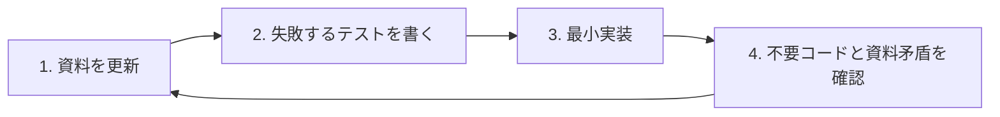

# AIエージェント向け開発ガイドライン

## 目的

このリポジトリは、WordPressの記事に3択フィードバックを設置し、結果を管理画面で集計するプラグインです。

すべてのエージェントは、実装前に次を読んでください。

1. [README.md](README.md)
2. [docs/requirements.md](docs/requirements.md)
3. [docs/data-model.md](docs/data-model.md)
4. [docs/api-specification.md](docs/api-specification.md)
5. [docs/prompt.md](docs/prompt.md)

## 絶対ルール

- 開発中のため、後方互換と既存データ移行は考慮しない。
- 常に現時点で理想的な設計へ置き換える。
- KISSを優先し、未確定の将来要件のために抽象化しない。
- 同じ意味の処理・設定・資料を複数箇所へ重複させない。
- WordPress標準APIを優先し、独自の仕組みを増やさない。
- セキュリティ境界では nonce、権限確認、入力の無害化、出力のエスケープを省略しない。
- 仕様とコードが矛盾する場合、推測でコードだけを直さず、まず資料を正す。

## 必須の開発サイクル

### 1. 資料を更新

- 変更する要件と受け入れ条件を `docs/requirements.md` に書く。
- DBを変える場合は `docs/data-model.md` を先に直す。
- HTTP入出力を変える場合は `docs/api-specification.md` を先に直す。
- READMEの利用手順に影響する場合は `README.md` も先に直す。
- 資料間に矛盾や古い説明がないことを確認する。

### 2. テストを書く

- 変更の受け入れ条件を、まず失敗する自動テストで表す。
- 正常系だけでなく、権限・nonce・不正入力・DB失敗を必要な範囲で含める。
- テストできない設計は、実装前に責務を小さく分ける。

### 3. 最小実装

- テストを通すために必要なコードだけを書く。
- 使われていない設定、互換レイヤー、汎用化、フラグは追加しない。
- 一度しか使わない薄いラッパーは原則作らない。

### 4. 最終確認

- 全テストを実行する。
- PHPの構文と変更ファイルを確認する。
- 不要コード、重複、古いコメントを削除する。
- 要件・データモデル・API仕様・READMEと実装が一致することを確認する。

## コーディング規約

- PHPはWordPress Coding Standardsを基準にする。
- クラス・関数・変数は責務が分かる名前にする。
- 関数は1つの目的に絞り、早期returnでネストを浅くする。
- SQLの値は `$wpdb->prepare()` または `$wpdb` の安全なAPIを使う。
- 入力は利用直前に `wp_unslash()` と用途別のsanitizeを行う。
- HTML属性、本文、URLは用途別にescapeする。
- JavaScriptは依存を増やさず、ブラウザ標準APIを使う。
- コメントは「何をしているか」ではなく「なぜ必要か」を書く。

## 完了条件

- 資料が実装より先に更新されている。
- 受け入れ条件を検証するテストがある。
- テストと構文確認が成功する。
- 実装と全資料に矛盾がない。
- 不要な互換処理、移行処理、未使用コードがない。
