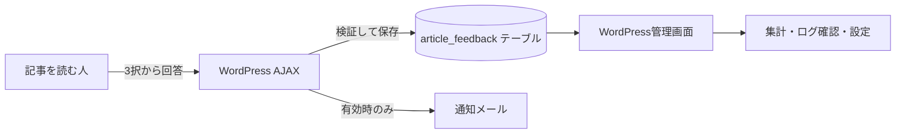

# Article Feedback

WordPressの記事に3択アンケートを表示し、回答を管理画面で集計する小さなプラグインです。

## できること

- ショートコードでフィードバックUIを表示
- 未ログイン利用者を含む回答の保存
- 選択肢、ページ、参照元、端末ごとの集計
- 回答ログの閲覧と1件削除
- 選択肢ラベルの変更
- ネガティブ回答時のコメント機能の有効・無効
- 新規回答のメール通知
- テーマ側テンプレートによる表示上書き

## 全体像



## 技術スタック

- WordPress Plugin API
- PHP
- WordPress AJAX API
- WordPress Database API (`$wpdb`)
- Vanilla JavaScript
- CSS

WordPressとPHPの最低対応バージョンは、現時点では未定義です。

## インストール

1. このリポジトリを `wp-content/plugins/article-feedback` に配置します。
2. WordPress管理画面の「プラグイン」で **Article Feedback** を有効化します。
3. 表示したい場所へショートコードを追加します。

```text
[article_feedback]
```

PHPテンプレートから表示する場合:

```php
<?php echo do_shortcode('[article_feedback]'); ?>
```

## 使い方

### 1. 記事へ設置

ショートコードを記事本文またはテンプレートへ追加します。

### 2. 表示文言と通知先を設定

WordPress管理画面の「記事フィードバック」を開きます。

- 3つの選択肢ラベル
- ネガティブ回答時のコメント機能の有効・無効
- メール通知の有効・無効
- 通知先メールアドレス

を設定できます。

### 3. 結果を確認

同じ画面で総件数、選択肢別、端末別、ページ別、参照元別の集計を確認できます。「ログ一覧」では全ログを50件ずつ表示し、1件単位で削除できます。

## 表示のカスタマイズ

テーマに次のファイルを置くと、プラグイン標準テンプレートより優先されます。

```text
テーマ/article-feedback/feedback.php
```

標準テンプレートは `templates/feedback.php` です。フロント側の見た目はテーマ側で指定してください。このプラグインが持つCSSは管理画面用のみです。

## 現在の構成

```text
article-feedback/
├── AGENTS.md
├── README.md
├── article-feedback.php       # WordPressが読み込むエントリーポイント兼実装
├── assets/
│   ├── admin.css              # 管理画面
│   └── feedback.js            # 回答送信
├── docs/
│   ├── requirements.md
│   ├── data-model.md
│   ├── api-specification.md
│   └── prompt.md
└── templates/
    └── feedback.php           # 標準表示
```

`src/` への分割は、テスト基盤と責務分割の要件を資料で定義してから行います。現状を説明する資料で、未実装の構成を装いません。

## 開発

変更前に [AGENTS.md](AGENTS.md) の開発サイクルを確認してください。

現時点では自動テスト基盤がありません。機能変更では、先に要件とテスト基盤を定義し、TDDで進めてください。最低限のPHP構文確認は次で行えます。

```bash
php -l article-feedback.php
php -l templates/feedback.php
```

## 詳細資料

- [要件定義](docs/requirements.md)
- [データモデル](docs/data-model.md)
- [API仕様](docs/api-specification.md)
- [エージェント用プロンプト](docs/prompt.md)
