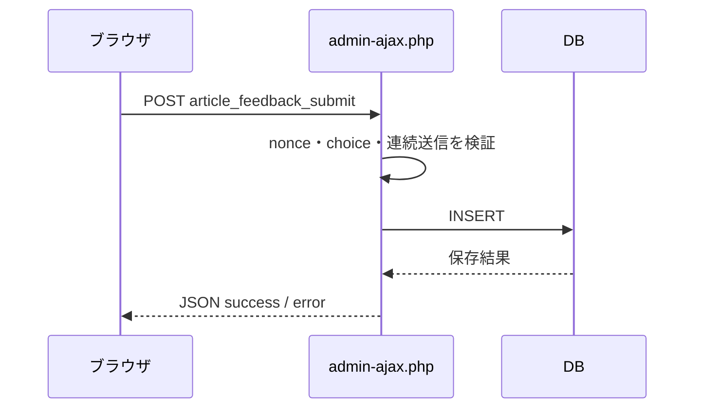

# API仕様書

## 概要

独自REST APIはありません。回答送信にはWordPress標準の `admin-ajax.php` を使います。



## フロントエンド設定

WordPressが `ArticleFeedback` グローバルへ次を渡します。

| キー | 型 | 内容 |
|---|---|---|
| `ajaxUrl` | string | `admin-ajax.php` のURL |
| `nonce` | string | action `article_feedback_nonce` のnonce |
| `postId` | integer | 現在の問い合わせ対象ID |
| `commentEnabled` | boolean | ネガティブ回答時のコメント機能が有効か |

## 回答送信

### リクエスト

- Method: `POST`
- URL: `ArticleFeedback.ajaxUrl`
- Content-Type: `application/x-www-form-urlencoded; charset=UTF-8`
- 認証: 不要
- nonce: 必須

| パラメータ | 必須 | 型 | 説明 |
|---|---:|---|---|
| `action` | 必須 | string | `article_feedback_submit` 固定 |
| `nonce` | 必須 | string | WordPress nonce |
| `post_id` | 任意 | integer | 投稿ID。空または0はDBでNULL |
| `choice` | 必須 | string | 下記3値のいずれか |
| `comment` | 条件付き必須 | string | コメント機能が有効なネガティブ回答では必須。前後の空白を除いて1〜1,000文字 |
| `url` | 任意 | URL string | 現在のページURL |

許可される `choice`:

```text
helpful
not_helpful
not_found
```

### 成功レスポンス

HTTP 200:

```json
{
  "success": true
}
```

### エラーレスポンス

| HTTP | message | 条件 |
|---:|---|---|
| 400 | `invalid_choice` | 選択肢が空または許可値以外 |
| 400 | `comment_required` | コメント機能が有効で、ネガティブ回答のコメントが空または空白だけ |
| 400 | `comment_too_long` | コメント機能が有効で、コメントが1,000文字を超える |
| 403 | WordPress標準nonceエラー | nonceが無効 |
| 429 | `too_fast` | 同じIPハッシュから10秒以内に送信済み |
| 500 | `insert_failed` | DBへの保存失敗 |

WordPress JSONエラーの基本形:

```json
{
  "success": false,
  "data": {
    "message": "invalid_choice"
  }
}
```

## 管理画面操作

### 設定保存

- Method: `POST`
- 送信先: 現在の「記事フィードバック」管理画面
- 必要権限: `manage_options`
- nonce action: `article_feedback_settings`
- nonce field: `article_feedback_settings_nonce`

| パラメータ | 内容 |
|---|---|
| `label_helpful` | 1つ目のラベル |
| `label_not_helpful` | 2つ目のラベル |
| `label_not_found` | 3つ目のラベル |
| `comment_enabled` | チェック時のみ送信され、コメント機能を有効化 |
| `notify_enabled` | チェック時のみ送信され、通知を有効化 |
| `notify_email` | 通知先メールアドレス |

成功後は `admin.php?page=article-feedback&updated=1` へリダイレクトします。

### ログ1件削除

- Method: `GET`
- URL: `admin-post.php`
- action: `article_feedback_delete_log`
- 必要権限: `manage_options`
- nonce action: `article_feedback_delete_log_{id}`

| パラメータ | 内容 |
|---|---|
| `action` | `article_feedback_delete_log` |
| `id` | 削除するログID |
| `_wpnonce` | 対象ID用のnonce |

成功後は `admin.php?page=article-feedback-logs&deleted=1` へリダイレクトします。

## セキュリティ境界

- 公開送信はログイン利用者・未ログイン利用者の両方に許可する。
- nonceはCSRF対策であり、認証や一人一票の保証ではない。
- 管理操作はnonceに加えて `manage_options` を必須とする。
- 受信値は `sanitize_key`、`absint`、`esc_url_raw`、`sanitize_text_field`、`sanitize_email` など用途別に処理する。
