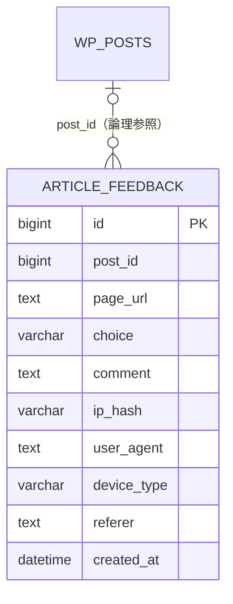

# データモデル

## 全体像



WordPressのテーブル接頭辞が `wp_` の場合、実テーブル名は `wp_article_feedback` です。外部キー制約は設けません。

## `{$wpdb->prefix}article_feedback`

| 列 | 型 | NULL | 意味 |
|---|---|---:|---|
| `id` | `BIGINT UNSIGNED AUTO_INCREMENT` | 不可 | 主キー |
| `post_id` | `BIGINT UNSIGNED` | 可 | 表示時の投稿ID。投稿外ではNULL |
| `page_url` | `TEXT` | 不可 | 回答したページURL |
| `choice` | `VARCHAR(100)` | 不可 | `helpful` / `not_helpful` / `not_found` |
| `comment` | `TEXT` | 可 | コメント機能が有効なネガティブ回答の必須コメント。最大1,000文字 |
| `ip_hash` | `VARCHAR(64)` | 可 | IP + WordPress saltのSHA-256 |
| `user_agent` | `TEXT` | 可 | 送信時のUser Agent |
| `device_type` | `VARCHAR(20)` | 可 | `pc` / `mobile` / `tablet` |
| `referer` | `TEXT` | 可 | HTTP Referer |
| `created_at` | `DATETIME` | 不可 | WordPress設定タイムゾーンでの送信日時 |

### インデックス

- 主キー: `id`
- 単一列インデックス: `post_id`、`choice`、`ip_hash`、`device_type`、`created_at`

### 保存ルール

- `post_id` が0の場合はNULLとして保存する。
- コメント機能が無効な場合、および `helpful` の `comment` はNULLとして保存する。
- コメント機能が有効な場合、`not_helpful` と `not_found` の `comment` は前後の空白を除いて1文字以上1,000文字以内とする。
- IPを取得できない場合、`ip_hash` は空文字列になる。
- 端末判定はUser Agentの単純なパターン照合であり、完全な識別を保証しない。
- `created_at` は `current_time('mysql')` を使う。
- プラグイン有効化時に `dbDelta()` で作成する。

## WordPress Options

| option_name | 値 | 既定値 |
|---|---|---|
| `article_feedback_labels` | 3つのキーを持つ配列 | 下表参照 |
| `article_feedback_comment_enabled` | `'1'` または `'0'` | `'0'` |
| `article_feedback_notify_enabled` | `'1'` または `'0'` | `'0'` |
| `article_feedback_notify_email` | メールアドレス文字列 | 空文字列 |

### ラベル既定値

| キー | 表示 |
|---|---|
| `helpful` | 役に立った |
| `not_helpful` | 役に立たなかった |
| `not_found` | 探している内容ではない |

## ブラウザ保存データ

送信成功時だけ、次のキーへUnix時刻（ミリ秒）を `localStorage` に保存します。

```text
article_feedback_{postIdまたはno-post-id}_{location.pathname}
```

値は60秒間のクライアント側再送抑制にのみ使います。

## データライフサイクル

- ログは管理画面から1件ずつ削除できる。
- 自動削除、保存期限、一括削除はない。
- プラグイン無効化・削除時にテーブルやOptionsを削除しない。
- 開発中の設計変更では移行処理を作らず、必要なら既存データを破棄して理想形へ作り直す。
