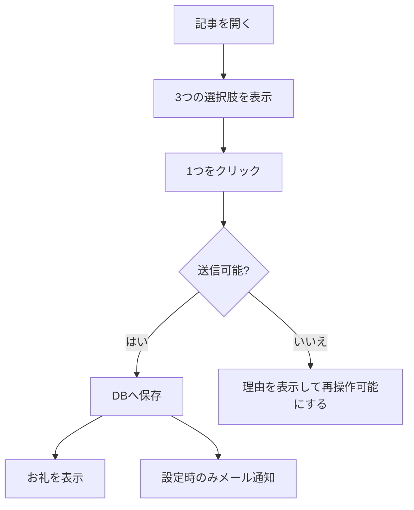

# 要件定義

## 1. 目的

記事を読んだ人が迷わず1クリックで評価でき、管理者が「どの記事を改善すべきか」を把握できるようにします。

## 2. 利用者

| 利用者 | やること |
|---|---|
| 訪問者 | 記事に対する3択回答を送る |
| 管理者 | 文言と通知を設定し、集計・ログを確認、不要ログを削除する |
| テーマ開発者 | ショートコードを設置し、必要なら表示テンプレートを上書きする |

## 3. ユーザーフロー

## 4. 機能要件

### FR-01 フィードバック表示

- `[article_feedback]` でUIを表示する。
- 質問は「この記事は役に立ちましたか？」とする。
- 選択肢キーは `helpful`、`not_helpful`、`not_found` の3つに固定する。
- 表示ラベルは管理画面で変更できる。
- テーマの `article-feedback/feedback.php` があれば標準テンプレートより優先する。

### FR-02 回答送信

- ログイン状態を問わず送信できる。
- nonceと選択肢をサーバーで検証する。
- 投稿ID、表示URL、選択肢、IPハッシュ、User Agent、端末種別、リファラ、日時を保存する。
- 成功後は選択肢を消し、お礼を表示する。

### FR-03 ネガティブ回答のコメント

- 管理者はコメント機能を有効または無効にできる。初期値は無効とする。
- コメント機能が有効な場合、`not_helpful` または `not_found` を選ぶと、コメント欄と送信ボタンを表示する。
- コメント機能が有効な場合、ネガティブ回答ではコメントを必須とし、空白だけのコメントも拒否する。
- コメントは1,000文字以内とする。
- 有効状態、必須条件、文字数上限をJavaScriptとPHPの両方で検証する。
- コメント機能が無効な場合、すべての選択肢をコメントなしで即時送信する。
- `helpful` は設定にかかわらず、コメント欄を表示せず即時送信する。
- コメントを回答ログとともに保存し、管理画面に表示する。
- メール通知が有効な場合は、通知本文にもコメントを記載する。

### FR-04 連続送信の抑制

- ブラウザは同じ投稿IDとパスに対し、送信成功後60秒間再送を抑制する。
- サーバーは同じIPハッシュから10秒以内の連続送信を拒否する。
- サーバー拒否時はHTTP 429を返す。

> これは厳密な一人一票制ではありません。操作ミスや短時間の連打を減らすための制限です。

### FR-05 管理画面

- `manage_options` 権限を持つ利用者だけが操作できる。
- 総件数、選択肢別、端末別、ページ別上位10件、リファラ別上位10件を表示する。
- 集計画面の最新ログは200件まで表示する。
- ログ一覧は新しい順に1ページ50件表示する。
- nonce検証後、ログを1件削除できる。

### FR-06 設定

- 3つの表示ラベルを保存できる。
- ネガティブ回答時のコメント機能の有効・無効を保存できる。
- メール通知の有効・無効と通知先を保存できる。
- 設定変更にはnonceと `manage_options` 権限を要求する。

### FR-07 メール通知

- 通知が有効で、通知先が有効なメールアドレスの場合だけ送る。
- 日時、選択肢、投稿ID、URL、端末、リファラ、IPハッシュ、User Agentを本文に含める。
- コメント付き回答の場合はコメントも本文に含める。
- DB保存成功後に送る。

## 5. 非機能要件

### セキュリティ

- 外部入力を用途別にsanitizeする。
- HTML出力を用途別にescapeする。
- 管理操作は権限とnonceの両方を検証する。
- IPアドレスそのものは保存せず、WordPress saltを加えたSHA-256ハッシュを保存する。

### 操作性

- コメント機能が無効な場合、および `helpful` は1クリックで回答を完了できる。
- コメント機能が有効なネガティブ回答では、選択後にコメントを入力して送信できる。
- 通信中はボタンを無効化する。
- 失敗時はボタンを再度操作可能にする。
- 管理画面は狭い画面でも1カラムに切り替わる。

### 保守性

- 後方互換とデータ移行は考慮しない。
- WordPress標準APIとブラウザ標準APIを優先する。
- 未使用の抽象化や将来用設定を持たない。
- 実装変更は資料更新、テスト、最小実装、矛盾確認の順で行う。

## 6. 対象外

- 厳密な重複排除や本人確認
- CSVエクスポート
- 期間指定の集計
- マルチサイト固有対応
- アンインストール時のデータ削除
- 外部分析サービスとの連携

## 7. 受け入れ条件

- ショートコードで3つの選択肢が表示される。
- 有効な回答はDBへ1件保存され、お礼表示に切り替わる。
- コメント機能を有効にした場合、2つのネガティブ回答は1文字以上1,000文字以内のコメントがなければ送信できない。
- コメント機能を無効にした場合、2つのネガティブ回答もコメントなしで即時送信できる。
- `helpful` はコメントなしで送信できる。
- 保存したコメントを管理画面と、有効化された通知メールで確認できる。
- 不正な選択肢はHTTP 400、10秒以内の連続送信はHTTP 429、DB失敗はHTTP 500になる。
- 管理者は集計、設定、ログ一覧、1件削除を利用できる。
- 権限のない利用者は管理機能を操作できない。
- 通知条件を満たす場合だけメールが送られる。
- `README.md`、本書、データモデル、API仕様とコードが一致している。
